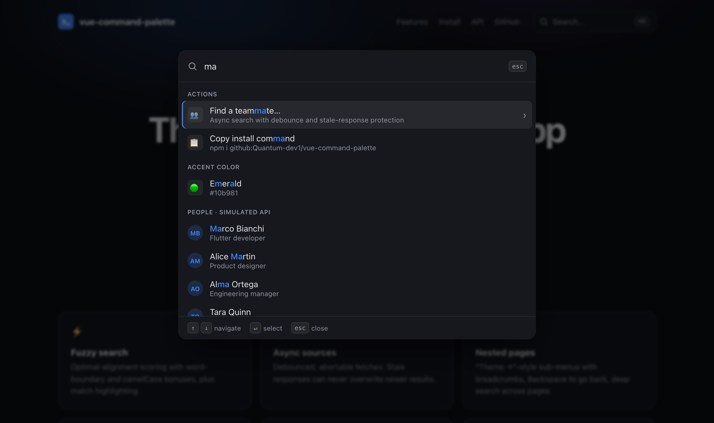
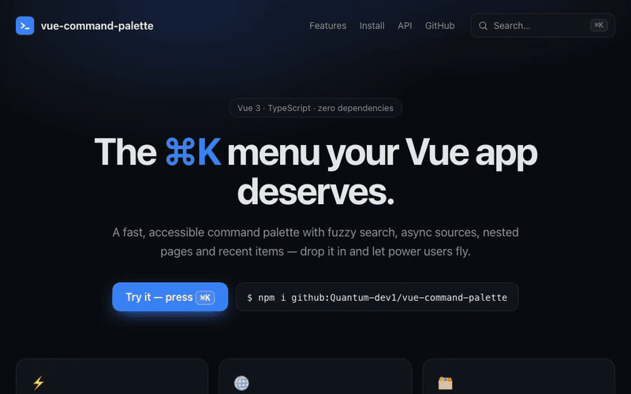
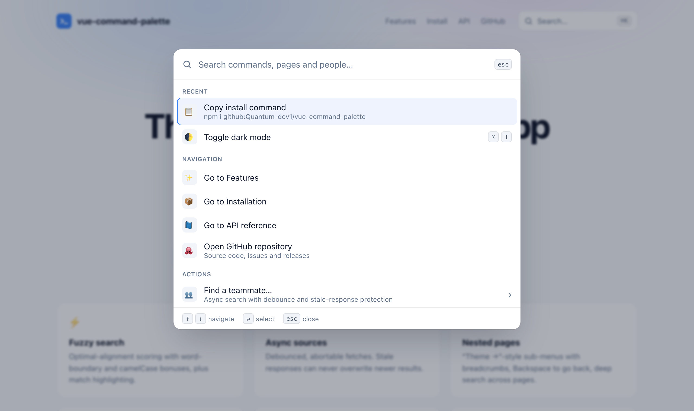

<div align="center">

# vue-command-palette

**A fast, accessible ⌘K command palette for Vue 3 — fuzzy search, async sources, nested pages and recent items, with zero runtime dependencies.**

[](https://github.com/Quantum-dev1/vue-command-palette/actions/workflows/ci.yml)
[](./package.json)
[](./LICENSE)




</div>

---

Give power users a keyboard-first way to navigate and act in your app. Drop in one component, pass an array of commands, and you get a polished Spotlight/Linear-style menu that is fully keyboard-driven, screen-reader friendly and themeable with CSS variables.

<p align="center"></p>

## Features

- **⌨️ Global hotkey** — `⌘K` on macOS, `Ctrl K` elsewhere (configurable, or disable it and control `v-model:open` yourself).
- **⚡ Fuzzy search with highlighting** — optimal-alignment scoring (word starts, camelCase humps, consecutive runs, gap penalties), multi-word queries in any order, `keywords` for synonyms, matched characters wrapped in `<mark>`.
- **🗂️ Groups / sections** — by `group`; sections are re-ordered by best match while you type.
- **🧭 Keyboard navigation** — `↑` `↓` (wrapping), `Home` / `End`, `Ctrl N` / `Ctrl P`, `Enter`, `Esc`; disabled items are skipped.
- **🌐 Async sources** — per-source debounce, `AbortSignal` cancellation, loading spinner, and **race-condition safety**: a slow response for an old query can never overwrite results for a newer one.
- **🕘 Recent items** — remembered in `localStorage` (with in-memory fallback) and shown first on an empty query.
- **📂 Nested pages** — "Theme →"-style sub-menus with breadcrumbs, `Backspace` / `Esc` to go back, parent query restored on return, and deep search that finds items inside pages from the root.
- **🧩 Custom item slots** — render avatars, badges or anything else; `CommandHighlight` helper renders match highlights for you.
- **♿ Accessible** — ARIA `combobox` + `listbox` + `option` with `aria-activedescendant`, labelled groups, `aria-modal` dialog, focus trap, focus restore on close, and a polite live region announcing result counts.
- **🎨 Theming** — `light`, `dark` or `auto` (follows `prefers-color-scheme`); every color, radius and size is a `--vcp-*` CSS variable. Respects `prefers-reduced-motion`.
- **🪶 Small & typed** — no runtime dependencies besides `vue`. Built output: ~8.6 kB gzipped JS + ~1.7 kB gzipped CSS. Full TypeScript types for props, events, slots and items.

## Quick start

```bash
npm i github:Quantum-dev1/vue-command-palette
```

```vue
<script setup lang="ts">
import { ref } from 'vue'
import { useRouter } from 'vue-router'
import { CommandPalette, type CommandItem } from '@quantumdev/vue-command-palette'
import '@quantumdev/vue-command-palette/style.css'

const router = useRouter()
const open = ref(false)

const items: CommandItem[] = [
  { id: 'dashboard', title: 'Go to Dashboard', group: 'Navigation', icon: '🏠', perform: () => router.push('/') },
  { id: 'billing', title: 'Billing', group: 'Navigation', keywords: ['invoices', 'plan'], perform: () => router.push('/billing') },
  { id: 'new-project', title: 'Create project', group: 'Actions', shortcut: ['N'], perform: () => createProject() },
  {
    id: 'theme',
    title: 'Change theme…',
    group: 'Preferences',
    page: {
      title: 'Theme',
      items: [
        { id: 'theme-light', title: 'Light', perform: () => setTheme('light') },
        { id: 'theme-dark', title: 'Dark', perform: () => setTheme('dark') },
      ],
    },
  },
]
</script>

<template>
  <button @click="open = true">Search… <kbd>⌘K</kbd></button>
  <CommandPalette v-model:open="open" :items="items" />
</template>
```

That's it: press `⌘K` / `Ctrl K` anywhere on the page.

### Run the demo locally

```bash
git clone https://github.com/Quantum-dev1/vue-command-palette.git
cd vue-command-palette
npm install
npm run dev          # demo at http://localhost:5173
```

## Usage

### Async sources

Sources are queried as the user types. Pass the `signal` to `fetch` so superseded requests are cancelled — and even if you don't, stale responses are discarded.

```ts
import type { CommandSource } from '@quantumdev/vue-command-palette'

const users: CommandSource = {
  id: 'users',
  group: 'People',
  debounce: 200,        // ms, default 200
  minQueryLength: 2,    // default 1; 0 = also fetch on an empty query
  filter: true,         // default true: re-rank results locally with the fuzzy matcher
  async fetch(query, signal) {
    const res = await fetch(`/api/users?q=${encodeURIComponent(query)}`, { signal })
    const data: { id: string; name: string; email: string }[] = await res.json()
    return data.map((u) => ({
      id: `user:${u.id}`,
      title: u.name,
      subtitle: u.email,
      perform: () => router.push(`/users/${u.id}`),
    }))
  },
}
```

```vue
<CommandPalette v-model:open="open" :items="items" :sources="[users]" />
```

Sources can also live on a nested page (`page: { sources: [...] }`), e.g. a dedicated "Find a teammate…" page.

### Custom item rendering

```vue
<script setup lang="ts">
import { CommandPalette, CommandHighlight } from '@quantumdev/vue-command-palette'
</script>

<CommandPalette v-model:open="open" :items="items">
  <template #item="{ item, segments, active }">
    <span class="my-icon" aria-hidden="true">{{ item.icon ?? '•' }}</span>
    <span class="vcp-item-text">
      <span class="vcp-item-title"><CommandHighlight :segments="segments" /></span>
      <span v-if="item.subtitle" class="vcp-item-subtitle">{{ item.subtitle }}</span>
    </span>
    <span v-if="active" class="hint">↵</span>
  </template>

  <template #empty="{ query }">No results for “{{ query }}”. <a href="/help">Ask support</a></template>
</CommandPalette>
```

### Commands that control the palette

`perform` receives a context object:

```ts
{
  id: 'search-docs',
  title: 'Search docs for…',
  closeOnSelect: false,
  perform: ({ query, setQuery, push, back, close }) => {
    push({ title: 'Docs', sources: [docsSource] })
  },
}
```

### Programmatic control

```vue
<script setup lang="ts">
const palette = ref<InstanceType<typeof CommandPalette>>()
palette.value?.open()          // also: close(), toggle(), back(), push(page), setQuery(text)
</script>

<template>
  <CommandPalette ref="palette" :items="items" :hotkey="false" />
</template>
```

## API

### Props

| Prop | Type | Default | Description |
| --- | --- | --- | --- |
| `v-model:open` | `boolean` | `false` | Open state. Works uncontrolled too (hotkey only). |
| `items` | `CommandItem[]` | `[]` | Commands on the root page. |
| `sources` | `CommandSource[]` | `[]` | Async sources on the root page. |
| `hotkey` | `string \| false` | `'mod+k'` | Toggle hotkey. `mod` = ⌘ on Apple, Ctrl elsewhere. Examples: `'ctrl+shift+p'`, `'alt+/'`. |
| `placeholder` | `string` | `'Type a command or search…'` | Root page placeholder (pages can override). |
| `emptyText` | `string` | `'No results found.'` | Empty state text (or use the `#empty` slot). |
| `loadingText` | `string` | `'Searching…'` | Shown while sources load and nothing matches yet. |
| `theme` | `'light' \| 'dark' \| 'auto'` | `'auto'` | Color scheme. |
| `recent` | `boolean \| { storageKey?, max?, label? }` | `true` | Recent items (`'vcp:recent'`, 5, `'Recent'`). |
| `searchNested` | `boolean` | `true` | Search inside nested pages when the query is not empty. |
| `limit` | `number` | `50` | Max static results per page. |
| `closeOnSelect` | `boolean` | `true` | Close after selecting an item with `perform` (per-item override). |
| `lockScroll` | `boolean` | `true` | Lock page scroll while open. |
| `teleport` | `string \| false` | `'body'` | Teleport target, or `false` to render in place. |
| `label` | `string` | `'Command palette'` | Accessible name of the dialog. |

Extra attributes (`class`, `style`, `data-*`) are applied to the palette root, so `:style="{ '--vcp-accent': brand }"` works.

### Events

| Event | Payload | When |
| --- | --- | --- |
| `update:open` | `boolean` | Opened/closed (hotkey, `Esc`, overlay click, selection). |
| `select` | `CommandItem` | An item was chosen (before `perform` runs). |
| `error` | `(error, item)` | An item's `perform` threw or rejected (also logged to the console). |

### Slots

| Slot | Props | Description |
| --- | --- | --- |
| `item` | `{ item, result, active, segments }` | Replace the row content. |
| `empty` | `{ query }` | Empty state. |
| `footer` | — | Replace the keyboard-hints footer. |

### `CommandItem`

```ts
interface CommandItem {
  id: string                    // unique; used for keys and recent items
  title: string                 // fuzzy-matched and highlighted
  subtitle?: string             // searchable (lower weight)
  group?: string                // section heading
  keywords?: string[]           // hidden search terms
  icon?: string                 // emoji/text icon (use the #item slot for SVGs)
  shortcut?: string[]           // hint chips, e.g. ['G', 'H'] — display only
  disabled?: boolean
  perform?: (ctx: CommandContext) => void | Promise<void>
  page?: CommandPage            // selecting opens this nested page
  closeOnSelect?: boolean
  data?: unknown                // anything, for custom slots
}

interface CommandPage { title?: string; placeholder?: string; items?: CommandItem[]; sources?: CommandSource[] }
```

### Keyboard

| Key | Action |
| --- | --- |
| `⌘K` / `Ctrl K` | Toggle the palette |
| `↑` `↓`, `Ctrl P` `Ctrl N` | Move (wraps, skips disabled) |
| `Home` / `End` | First / last item |
| `Enter` | Run the active command or open its page |
| `Esc` | Back one page, or close on the root page |
| `Backspace` (empty query) | Back one page |
| `Tab` / `Shift Tab` | Cycle focus inside the dialog (breadcrumbs ↔ input) |

### Theming

Override any variable on `.vcp-root` (or pass a `style` attribute):

```css
.vcp-root {
  --vcp-accent: #7c3aed;
  --vcp-match: #7c3aed;
  --vcp-radius: 18px;
  --vcp-width: 720px;
  --vcp-font: 'Inter', sans-serif;
}
```

Available tokens: `--vcp-font`, `--vcp-font-size`, `--vcp-width`, `--vcp-max-height`, `--vcp-top`, `--vcp-radius`, `--vcp-item-radius`, `--vcp-z`, `--vcp-bg`, `--vcp-fg`, `--vcp-muted`, `--vcp-border`, `--vcp-overlay`, `--vcp-shadow`, `--vcp-item-active-bg`, `--vcp-item-active-fg`, `--vcp-accent`, `--vcp-match`, `--vcp-match-bg`, `--vcp-kbd-bg`, `--vcp-kbd-fg`, `--vcp-kbd-border`.

<details>
<summary>Light theme screenshot</summary>

</details>

### Utilities

The building blocks are exported too, so you can reuse them outside the component:

```ts
import { fuzzyMatch, matchFields, highlight, rankItems, AsyncSearch, useHotkey, formatHotkey } from '@quantumdev/vue-command-palette'

fuzzyMatch('gs', 'Go to Settings')   // { score: …, indices: [0, 6] }
formatHotkey('mod+k')                // '⌘K' on macOS, 'Ctrl K' elsewhere
useHotkey('alt+t', toggleTheme)      // global shortcut bound to the component lifecycle
```

## Architecture

```
src/
├── CommandPalette.vue      # UI, ARIA wiring, keyboard handling, page stack, open/close lifecycle
├── CommandHighlight.ts     # <mark> renderer for custom slots
├── core/                   # framework-agnostic, unit-tested logic
│   ├── fuzzy.ts            # O(query × target) DP matcher → score + match indices
│   ├── search.ts           # ranking, grouping, nested-page flattening
│   ├── async-search.ts     # debounce + AbortController + sequence numbers per source
│   ├── recent.ts           # MRU ids in localStorage with safe fallback
│   ├── hotkey.ts           # combo parsing / matching / formatting
│   └── focus-trap.ts       # Tab cycling inside the dialog
└── composables/useHotkey.ts
```

- **Fuzzy matching** is a dynamic program that finds the *best* alignment of the query in the target, not the first greedy one, so `ab` in `xa-xbxab` highlights the contiguous `ab`. Multi-character terms whose best alignment is too scattered are rejected, which keeps noise out of the list.
- **Race safety**: each source has a sequence counter. Scheduling a search increments it and aborts the previous `AbortController`; a response is applied only if its sequence number is still current. Sources are re-run only when the query, the page or the *set of source ids* changes, so inline `:sources="[...]"` arrays are safe.
- **Nested pages** are re-resolved from the live `items` prop by item id, so reactive changes (like a "Current" badge) appear while the page is open.
- The library is built with Vite library mode (ESM + extracted CSS); declarations are emitted by `vue-tsc`.

## Development

```bash
npm run dev          # demo with HMR
npm test             # Vitest + @vue/test-utils (jsdom)
npm run typecheck    # vue-tsc
npm run lint         # ESLint (typescript-eslint + eslint-plugin-vue)
npm run build        # dist/: ESM bundle, style.css, .d.ts
npm run screenshot   # rebuild demo and regenerate docs/*.png + docs/demo.gif (Playwright; GIF needs ffmpeg)
```

## Roadmap

- [ ] Virtualized list for very large static item sets (10k+)
- [ ] Optional execution of item `shortcut`s as global hotkeys (today they are display-only)
- [ ] Localizable footer hints and screen-reader strings via props
- [ ] Nuxt module with auto-import
- [ ] Lazy `page` loaders (`page: () => Promise<CommandPage>`)

Ideas and PRs welcome — open an issue to discuss.

## Contributing

1. Fork and create a branch: `git checkout -b feat/my-change`
2. `npm install`, then make your change with tests
3. Make sure `npm run lint && npm run typecheck && npm test && npm run build` pass
4. Open a pull request describing the change and its motivation

See [CONTRIBUTING.md](./CONTRIBUTING.md) for details.

## License

[MIT](./LICENSE) © Quantum Dev

---

Built by [Quantum Dev](https://quantumdevteam.com) — we build web platforms, mobile apps and AI agents. Need something like this for your business? [Book a call](https://cal.com/aleksandr-ganus/30m).
